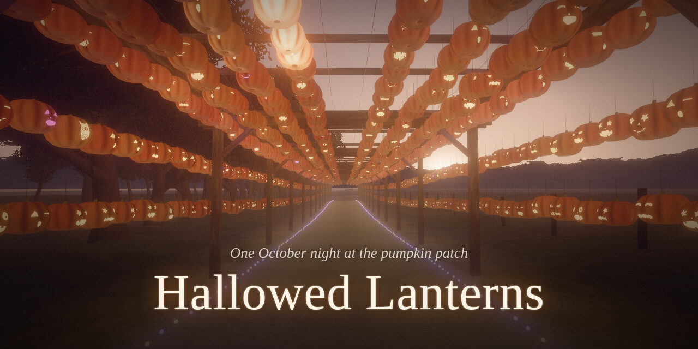

# Hallowed Lanterns



One October night at the pumpkin patch, as an immersive walk: follow a runaway candle flame — the
Ember — from a sunset tunnel of jack-o'-lanterns, through a candle-lit grove, a garden of red
lanterns, a pasture of glowing giants, a hollow full of candy, an impossible October snow and a
deep blue sea, to an ofrenda and a Wishing Tree.

It's an [All the Spaces](https://github.com/shooter-git/all-the-spaces) **creation**: people open it
from an object in their space, together, on a phone, a tablet or a laptop. It runs entirely in the
browser (three.js, WebGL2), with no network once loaded.

The story, chapter by chapter, is in [docs/STORY.md](docs/STORY.md); how it's built, in
[docs/DESIGN.md](docs/DESIGN.md).

## The night

| | Chapter | |
|---|---|---|
| I | The Arbor of Faces | The hay-bale sign at sunset, then a lane under hundreds of carved jack-o'-lanterns that wake as the sun goes. One loses its flame. |
| II | The Candle Grove | Blue hour. Candle-carved pumpkins hang in the trees over red-lit rolling fog, which wells out of a magical well; the Ember plays hide and seek. |
| III | The Lantern Garden | A tunnel of red lanterns the Ember lights as it runs ahead, the Lantern Sky, a giant owl, and a lounge where you can sit. |
| IV | The Pasture of Giants | Three enormous glowing longhorns breathe under the stars; then a picture show in a clearing. |
| V | Sweet Hollow | Through the Web (a pumpkin spider, a neon mantis), past a giant fly-eating Venus flytrap, to candy land under a violet oak. Play the Ember's song on the letter pumpkins. |
| VI | October Snow | It snows; a gourd snowman raises his corn-cob mug; the snowflakes slow, stop, and rise… |
| VII | The Deep | …into bubbles. Pumpkin jellyfish, the Kraken's Wreck and its treasure, and the Keeper of the Deep, who waves back. |
| VIII | The Marigold Garden | Light a candle at the ofrenda, play the giant guitar, write a wish and hang it on the Wishing Tree. |

You walk at your own pace the whole way (or let "Walk with me" walk for you). Candles you light
and wishes you hang are kept for your group, and everyone in the session walks the same night as a
light in their own colour.

## Running it

```bash
pnpm install
pnpm dev        # http://localhost:5173 — on its own, you're the only player
pnpm build      # dist/ is what publishing builds (with the platform's own settings)
pnpm typecheck
```

While developing, `?at=<metres>` starts straight away partway along the first chapter,
`?chapter=<n>` starts at chapter n (0–7), and `?tier=low|mid|high` forces a quality level.

## Putting it on an object in a space

This repository is shaped the way All the Spaces expects a creation from a repository to be
(`ats.json`, `assets.lock.json`, `package.json`, `index.html` at the root; the portal SDK vendored
in `vendor/`), so a server can follow it:

1. On the server, allow this repository in a source definition — `sources/github.json` in the
   install folder — and restart the server. The repository is public, so no token is needed:

   ```json
   { "id": "github", "displayName": "GitHub", "kind": "github",
     "repositories": ["shooter-git/hallowed-lanterns"] }
   ```

2. In the Studio's **Creations** page, choose the object, then **Make a creation from a
   repository**: `shooter-git/hallowed-lanterns`, folder `/`, following **releases** (the default).
3. Publish a GitHub release here whenever you want the space to pick up changes (a bare tag
   isn't enough: the server asks GitHub for the latest release). Architects see it and press
   **Update**. Every version is checked on a phone, a tablet and a laptop first.

## On its own, as an app

Each release is also published on its own at
**https://shooter-git.github.io/hallowed-lanterns/** (GitHub Pages, by
`.github/workflows/pages.yml`). There it can be added to a home screen: Share → **Add to Home
Screen** on an iPhone or iPad, ⋮ → **Add to Home screen** (or **Install app**) in Chrome on
Android, the install icon in the address bar on a computer. It opens full screen with its own
icon, and once the night has been walked through it plays offline. Candles and wishes are kept on
that device.

None of this reaches All the Spaces:

- the manifest is added by `src/installable.ts` only when it's opened directly (in a space it's
  a sealed frame, whose policy would refuse it);
- the service worker (`tools/pwa-sw.js`, written into the build by `tools/pwa.mjs`) is only in
  `pnpm build`: the platform builds with its own settings and ignores `vite.config.ts`;
- so are the manifest and its icons, which live in `pwa/` (not `public/`, which every build
  copies): the platform's checks refuse to serve a manifest, and its download is lighter without
  them. Only the favicon and the iPhone's home-screen icon, which the page links itself, are in
  `public/icons/`;
- the icons are listed in `assets.lock.json`, and `node tools/icons.mjs` makes them again from
  the engine's own view of the Arbor of Faces.

Before the first release that publishes it, set **Settings → Pages → Source** to **GitHub
Actions**, and in **Settings → Environments → github-pages**, add a deployment tag rule `v*`
(releases deploy from their tag).

## How it's made

- `src/engine/` — the renderer (HDR, bloom, AgX), the glow field that lets hundreds of lanterns
  light the ground and fog, carved-pumpkin and paper-lantern shaders, the terrain, the walk,
  the Ember, sound, the people walking with you, the interface.
- `src/chapters/` — one module per chapter, each loaded only when you get there.
- `src/scenes/` — set pieces placed inside chapters (the owl, the picture show, the Web, the
  Kraken's Wreck, the guitar).
- `tools/blender/` — Blender scripts that model the longhorns, the octopus, the snowman, the
  ofrenda and the rest (`blender -b --factory-startup -P tools/blender/<name>.py`).
- `tools/audio/` — the soundtrack and every sound, composed and made in Python: a sampler that
  plays the VSCO 2 CE orchestra, synthesised textures, and real CC0 foley cut into sounds (see
  its README).
- `node tools/lock-assets.mjs` — records new models and sounds in `assets.lock.json` as our own.

Every picture, model and sound is made by this project's own tools, with five kinds of borrowed
recordings, all free for anyone to use (the Iowa samples without restriction, the rest released
under CC0):

- The orchestra is played from [VSCO 2 Community Edition](https://github.com/sgossner/VSCO-2-CE)
  by Versilian Studios: the score is composed and performed by `tools/audio`, on their recordings.
- The picture show's clarinet and bassoon are the
  [University of Iowa Musical Instrument Samples](https://theremin.music.uiowa.edu/MIS.html),
  recorded by the University of Iowa Electronic Music Studios and free to use in any project
  without restriction.
- The Arbor's vibraphone, the Lantern Garden's zither, temple gong, finger cymbals, temple block and
  clay-flute ocarina, the Marigold Garden's gong and shaker, and October Snow's woodblock and finger
  cymbals come from the [Versilian Community Sample Library](https://github.com/sgossner/VCSL), also
  by Versilian Studios.
- October Snow's double bass is [Meatbass](https://github.com/sfzinstruments/karoryfer.meatbass)
  by Karoryfer Samples: a 1958 Otto Rubner double bass, played and sampled by Drogomir Smolken.
- The footsteps, the wind in the leaves, the grass and the snow, the night meadow of the Pasture,
  the fly and the flytrap, the coin down the well, the match that lights the ofrenda's candles and
  the sea surging as the Keeper rises are cut from studio foley and field recordings by Joseph
  Sardin ([BigSoundBank](https://bigsoundbank.com)).

Thank you, all of you.

## Privacy

The reference photos this was built from include family members. They stay on the computer that
built it, in `reference/`, which git ignores. Nothing in the creation shows a real person.
